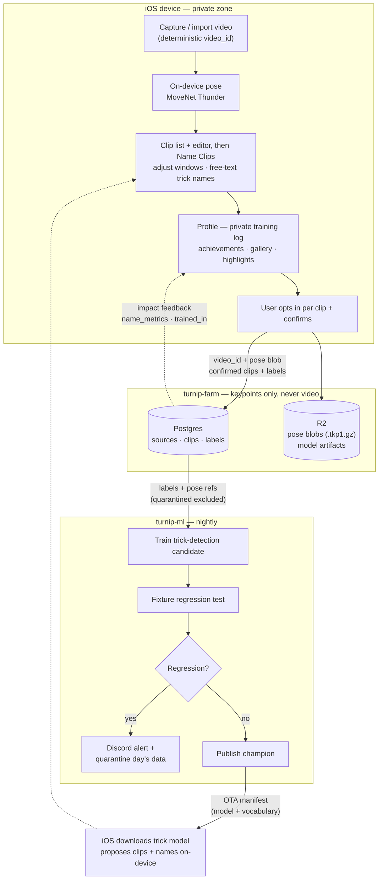

# Turnip Farm + ML Master Plan

*Rev 5 · 2026-10-15 · Draft for review.*

*Rev 1 established the direction. Rev 2 incorporated the maintainer's
gap-review decisions (confirmed contribution flow, TKP1 format, output contract,
vocabulary versioning, quarantine design, phasing, overview diagram).
Rev 3 makes source/clip IDs deterministic (derived, not random) so they
survive app reinstalls, and adds the reinstall reconciliation flow.
Rev 4 unlinks contributions from accounts: ownership is a per-source
key held by the client, the account link lasts 30 days after a source's
last write (for anti-poisoning attribution only), training splits by
source, and reputation is no longer computed from labels.
Rev 5 adds the Profile tab: a private, on-device training log
(achievements per trick, a gallery by trick name, highlight videos) is
what motivates naming clips, and the farm stores none of it. Labels
carry provenance and a blind sample guards against rubber-stamped model
suggestions, the vocabulary is served apart from the model, the
manifest and source reads carry impact feedback, validation leakage
becomes a measured risk, and Rev 4's unlinking is kept with recorded
reopen triggers.*

This document is the master plan for `turnip-farm` (backend + dataset) and
`turnip-ml` (training), and the contract they hold with `turnip-ios`.
It **supersedes** the backend, labeling, and ML sections of
`turnip-ios/docs/DESIGN.md` (Rev 8) on the points listed in §8, and
records the direction changes the maintainer made on 2026-10-05 (1–3)
and 2026-10-15 (4):

1. **Community labeling with free-text trick names.** Users label their
   clips; labels are free-text, the UI prompts for the trick name, and a
   clip can carry multiple labels (e.g. a combo: `hook`, `scoot`,
   `gainer`, `cartfull`).
2. **Privacy-first farm: no video, ever.** Clips are never sent to the farm
   as video data. What leaves the device is an opaque video identifier plus
   the pose keypoint sequence. The iOS client matches server-side label data
   back to local videos using the video identifier.
3. **The ML engine trains a trick detection model, not a pose model.** The
   model takes a pose key sequence and answers *where the tricks are*
   (start/end frame of each trick) and *what they are called* (trick names).
   Eventually it runs on-device, turning the pose stream directly into a
   list of named clips.
4. **A private training log motivates labeling.** The app's Profile tab
   — achievements per trick, a gallery of clips grouped by trick name,
   and highlight videos — is built from the names users give their own
   clips. It lives on the device only; the farm stores no profile,
   score, or achievement state (§1). A name is worth getting right
   because the user's own gallery and progress depend on it, and
   contributing the named clips stays a separate, per-clip opt-in.

`turnip-ios` remains the capture / pose / clip / export app. Pose detection
itself stays on-device (MoveNet Thunder, bundled) — the farm and the ML
pipeline never see a pixel.

## Overview



Video pixels never cross the device boundary — only the pose keypoint
sequence, opaque identifiers, and confirmed labels travel to the farm.
The loop is closed: better labels → better model → better on-device
proposals → easier labeling → a fuller Profile, which is what makes the
next name worth giving. The Profile itself never crosses the boundary;
what crosses back is impact feedback (§4): how well the current model
knows each trick, and which of the user's own contributed sources
trained it.

The confirmed contribution flow (no drafts on the server):

1. User creates clips and names them on-device — proposed by Turnip's
   detection model, or by hand. Named clips land in the private Profile
   (§5.6) whether or not they are ever contributed.
2. User opts in per clip and confirms the clips and labels, on-device.
3. The confirmed clips and labels are sent to the farm and persisted.
   If clip IDs match existing ones, the labels are overridden (upsert).
4. The farm runs nightly ML jobs and publishes the detection model.
5. iOS clients check for model updates periodically and download them.
6. Repeat from 1.

## 1. Privacy architecture

This is the keystone. Everything else follows from it.

**Never leaves the device:** video pixels, audio, location, photo-library
identifiers, device identifiers, contacts, or anything derived from them.
Nor does the Profile (§5.6): achievements, levels, progress, the
gallery's grouping, highlights, favorites, named spots, and whether a
clip shows the user or someone else.

**May leave the device (per explicit per-clip opt-in):**
- `video_id` — an opaque, **deterministic** identifier derived on-device
  (see §2): for Photos-backed videos,
  `SHA-256("turnip:phasset:" + PHAsset.localIdentifier)`; for imported
  files, `SHA-256(file bytes)`. Deterministic — not random — so the ID
  survives app reinstalls (the localIdentifier belongs to the Photos
  library, not the app). Still opaque to the server: non-reversible, and
  not derivable from video bytes by anyone without the Photos entry, so
  it cannot be joined against outside video datasets. One ID per source
  video. Side benefit: re-contributing the same video upserts instead of
  duplicating training data.
  Caveat: for imports the ID is `SHA-256(file bytes)`, so two users
  importing the identical file compute the identical `video_id` —
  joinable against identical files (which is also what enables the dedup
  side-benefit).
- Pose keypoint sequence — per sampled frame, the model's keypoints
  (`x`, `y`, `confidence`, normalized). A stick figure: no face, no
  background, no clothing, no identity.
- Label payloads — confirmed clip windows (frame ranges) and free-text
  trick names.
- Label provenance — per name, whether it was typed, picked from the
  vocabulary, or kept from the model's suggestion; per clip, the model
  version that proposed it, the names the model pre-filled (or would
  have, on a blind clip), and whether suggestions were withheld for the
  blind sample (§6). It describes how a label was made, never who made
  it.
- Account subject — the Sign in with Apple `sub` claim, which is already
  per-app opaque. Needed for sign-in, rate limiting, and blocking. It is
  linked to a contribution only for quarantine attribution (§6), and
  only until 30 days after the contribution's last write; after that
  the contribution has no account link. Ownership of a contribution is
  a per-source key the client holds, not the account.

**Why keypoints are safe enough:** a pose sequence contains no biometric
image data. Residual honesty: gait-from-keypoints is a real (if nascent)
research area, so we store the minimum viable representation (keypoints
only, no raw sensor data) and keep accounts pseudonymous. No mitigation
beyond minimization is warranted at this scale.

**No server-side profile (decided 2026-10-15).** The Profile tab
(§5.6) is computed on the device from the device's own clip library.
Achievements, levels, progress, scores, and highlights are never sent
to the farm, and the farm has no table for them. A server-side profile
would have to know which contributions are whose, which is exactly the
link the 30-day window removes. Leaderboards, public profiles, and any
other public view of achievements are out of scope for that reason and
for a second one: a private log gives nobody a reason to mislabel, and
an audience would. *Reopen if:* a social feature is put on the roadmap
— and then design it as opt-in linking (below), never as a default.

**Unlinking stays (decided 2026-10-15).** Linking contributions to
accounts was weighed again for the Profile tab and kept off. What
linking would buy: complete deletion (today a contribution whose source
key the app has lost survives account deletion, unlinked), splits by
person instead of by source, per-labeler reliability, restore on any
device, and fewer moving parts in the farm. What it would cost: one
re-identified video would identify every other video under the same
account, linked pose data is plainly personal data, and the app's
privacy label would read "linked to you". The Profile needs none of it.
Nor is unlinking a one-way door: the client keeps a key for every source
it contributed, so an opt-in "link my contributions" call can later
re-link the ones it still holds keys for, on the user's say. *Reopen
if:* counsel answers that unlinked pose sequences are still personal
data (`BACKEND_DESIGN.md` §9 Q9) — unlinking would then keep its costs
(the deletion gap, source-level splits, the moving parts) and lose most
of its benefit — or a social feature is put on the roadmap. A reversal
lands before the farm's first deployment, while restoring `user_id` is
still a plain additive migration.

**What this kills from DESIGN.md Rev 8:** presigned video upload to R2,
server-side video storage, server-rendered video feed, and every sentence
with "upload the video to the backend" in it. R2 stays — for pose blobs
and model artifacts, not video.

## 2. Data model (farm)

Postgres. Additive migrations via `dbmate` from day 1 (unchanged
convention). Identity rule: **`sources.id` is the deterministic
`video_id` derived on-device per §1** — the farm never mints source
identities, which is what makes client↔server matching and idempotent
re-submission work. `clips.id` is client-minted (UUIDv4) once and
recovered from the server after reinstall (§5.1), not re-derivable.
All writes below are upserts on ID match.

**ID stability.** Random IDs would die with the app's local store on
reinstall, orphaning the server-side data. So IDs are deterministic:
`sources.id` is derived per §1 (stable across reinstalls via the Photos
library identity or file bytes); `clips.id` is recovered from the
server, not recomputed — on a fresh install the client recomputes its
video_ids, calls `GET /api/sources/:id`, and adopts the returned clip
IDs into its rebuilt local state. Videos deleted from the library stay
on the server as training data; the client simply cannot relink them.

- `users` — `id` (the Apple `sub`), `reputation` (unused, §9 Q3),
  `is_blocked`, `created_at`; sign-in sessions per `BACKEND_DESIGN.md`.
  Holds no personal data beyond what Apple gives us, and no display
  name or profile: the Profile lives on the device (§1).
- `sources` — one row per contributed source video. `id` CHAR(64)
  (SHA-256 hex digest per §1, PK), `source_key_hash` (ownership: hash
  of a key the client holds; no account column), `frame_count`,
  `sample_rate` (as sent, provenance), `keypoint_format`
  (e.g. `tkp1`, versioned), `r2_key` (pose blob), `sha256` (hex
  digest of the blob — integrity check, consistent with the model
  manifest's checksum), `created_at`, `updated_at`. No video bytes.
  No thumbnails.
- `clips` — `id` UUID (client-minted once, PK — recovered from the
  server after reinstall, not re-derivable), `source_id` FK,
  `start_frame`, `end_frame`, `auto_detected` (bool: heuristic now,
  trick model later), `proposal_model_version` (the trick model that
  proposed the window or names; null for the heuristic or a manual
  clip), `suggested_names` (the names that model pre-filled, or would
  have on a blind clip, kept or removed), `suggestions_withheld`
  (bool: the blind sample, §6), `created_at`, `updated_at`.
  Hierarchy: **Source → Clip → Label**, all one-to-many.
- `labels` — one row per `(clip_id, trick_name)` (`BACKEND_DESIGN.md`
  §1.1): `trick_name` (free text, **multiple per clip** as multiple
  rows; re-submission replaces the clip's whole set), `origin` (`typed`
  | `vocabulary` | `model`: typed by hand, picked from the vocabulary,
  or kept from the model's suggestion), `taxonomy_version` (vocab in
  effect at label time), `created_at`, `updated_at`. The label window
  is the clip window. `crop_rects` are gone: with keypoints the
  athlete's location is already known, and crop is a client-side
  rendering concern.
- `label_taxonomy` — `raw` → `canonical` mapping, `taxonomy_version`
  (monotonic int, bumped when canonical names are added/changed),
  `first_seen`. Free text is preserved forever; training consumes
  canonical names. Seeded from standard tricking vocabulary. Renaming a
  canonical name remaps, at the new version, every raw string that
  pointed at the old canonical (the old canonical included) to the new
  one (`BACKEND_DESIGN.md` §3), so a name given under an older version —
  and an achievement earned on it (§5.6) — resolves forward instead of
  falling out of the vocabulary.
- `models` — `id`, `version`, `model_type` (`trick-detection`),
  `taxonomy_version` (the vocab the model trained on), `r2_key`,
  `val_metrics` (JSONB), `name_metrics` (JSONB: per canonical name,
  holdout precision and recall plus holdout and training example
  counts — the impact feedback, §4), `promoted_at`.
- `model_training_sources` — `model_version` FK, `source_id` FK: which
  sources trained each promoted model. Source-level, no account; the
  owner reads it through `GET /api/sources/:id` (§4). Deleted with the
  source.
- `source_attribution` — `source_id` FK, `user_id` FK, `attributed_at`:
  the account that last wrote the source, deleted 30 days after that
  write. The only link between a contribution and an account, kept as
  the "basic level of identification" for bad data (§6).
- `data_quarantine` — `id`, `source_id` FK, `reason`,
  `metrics` (JSONB snapshot), `quarantined_at`, `reviewed_at`,
  `resolution` (`released` | `purged`). The training export excludes
  quarantined sources. This is the anti-poisoning work queue (§6).
- `reports` — retargeted at labels/clips (was: videos).
- `follows` / feed — **deferred**. A server video feed cannot exist
  without server video. Social sharing stays where DESIGN.md put it:
  the iOS Share Sheet, zero server involvement.
- Profile, achievement, score, and leaderboard tables — **none, by
  decision** (§1). The Profile is on-device state.

## 3. Pose interchange format (`TKP1`)

The canonical encoding for pose keypoint sequences, on the wire and in
R2. One format, versioned — no JSON variant (clients may log JSON
locally, but the wire/storage format is binary).

**Temporal conventions:**
- Canonical sample rate: **10 Hz**. Clients send at their analysis rate
  (the iOS setting, 1–30, default 10); the farm **resamples to 10 Hz on
  ingest** and stores canonical only. `sample_rate` on the source row
  records the as-sent rate for provenance.
- Resampling: linear interpolation of `x`/`y`; confidence interpolated
  linearly. **Gaps break interpolation** — if either bracketing frame is
  a gap, the resampled frame is a gap. Never synthesize pose across
  missing data.

**Keypoint conventions (MoveNet 17, COCO order):**
`0 nose, 1 left_eye, 2 right_eye, 3 left_ear, 4 right_ear,
5 left_shoulder, 6 right_shoulder, 7 left_elbow, 8 right_elbow,
9 left_wrist, 10 right_wrist, 11 left_hip, 12 right_hip,
13 left_knee, 14 right_knee, 15 left_ankle, 16 right_ankle.`

**Spatial conventions:** `x`, `y` normalized 0–1 relative to source
frame dimensions (values may fall outside [0,1] in letterbox-pad regions
— recorded as-is, never clamped, per the iOS convention). `confidence`
0–1 per keypoint, as emitted by the model.

**Gap representation:** a frame with no usable pose is all zeros
(`x=0, y=0, confidence=0` for all 17 keypoints). Consumers treat any
all-zero-confidence frame as missing. Fixed-size, no special-casing in
the binary layout.

**Binary layout** (whole blob gzip-compressed):

```
offset  size  field
0       4     magic "TKP1"
4       2     format_version (uint16, =1)
6       2     keypoint_count (uint16, =17)
8       4     frame_count (uint32)
12      4     sample_rate_hz (float32, canonical 10.0)
16      4     source_sample_rate_hz (float32, as sent)
20      4     flags (uint32, reserved = 0)
24      …     frame_count × 17 × 3 float32 LE (x, y, confidence)
```

Size: 24 + `frame_count` × 204 bytes → ~2 KB/s at 10 Hz; a 60-second
session is ~122 KB.

## 4. API (farm)

Bun + TypeScript + Postgres (unchanged stack). Auth via Sign in with
Apple (unchanged contract). `sources.id` is the §1 SHA-256 hex digest;
`clip_id`s are client-minted UUIDs; every write is an upsert on ID
match.

- `POST /api/sources` — register a source for a confirmed contribution:
  `{video_id, source_key, frame_count, sample_rate, keypoint_format}`,
  answered with a presigned R2 PUT for the pose blob. Upload the **full
  source pose sequence once**; clips are frame windows into it.
- `POST /api/clips` — batch upsert of a source's confirmed clips and
  their label sets: `{clips: [{clip_id, source_id, source_key,
  start_frame, end_frame, auto_detected, proposal_model_version,
  suggested_names, suggestions_withheld, labels: [{name, origin}]}]}`.
  Re-submission with matching IDs overrides clips/labels (idempotent).
- `POST /api/clips/:id/labels` — label-only update (re-label without
  re-uploading the source): `{source_key, labels: [{name, origin}]}`.
  Upsert on `clip_id`.
- `GET /api/sources/:id` — fetch your own source (proven by its source
  key) with its confirmed clips + labels, matched by `video_id`
  (device restore), plus `trained_in`: the promoted model versions the
  source trained (impact feedback). This is the "client matches server
  label data using the video identifier" mechanism. There is no "list
  my sources" call: the farm doesn't know which sources are whose; the
  client does, from the source keys it holds.
- `GET /api/sources/:id/pose` — owner-only (source key) presigned R2
  GET of the source's TKP1 pose blob. Used by a device that no longer
  holds the local video but still holds the key (reinstall restore) to
  render skeleton previews from keypoints alone (§5.5). Presigned per
  request, scoped to the single blob, short-lived; the key requirement
  is what keeps one user's pose sequences from ever being downloadable
  by another.
- `DELETE /api/sources/:id` — owner-only (source key) hard delete
  (row + R2 blob).
  Same "keep forever, user-deletable" retention posture.
- `GET /api/models/current` — trick-model manifest: version, URL,
  checksum, `taxonomy_version`, the vocabulary list
  `[{canonical, aliases[]}]`, and `name_metrics` (how well this model
  knows each trick, and how many examples it learned from). No sign-in:
  nothing in it is user-specific, and a user who never contributes
  still gets the model.
- `GET /api/taxonomy/current` — the current vocabulary,
  `{taxonomy_version, vocabulary}`, served apart from the model so the
  app can suggest and group names before any model is promoted and
  between promotions. No sign-in.
- `POST /api/models` — training pipeline publishes the champion
  (admin-scoped), with its `name_metrics` and the ids of the sources it
  trained on.
- `GET /api/labels/export?since=` — training pipeline pull: labels +
  provenance + pose blob references since a watermark. **Excludes
  quarantined sources.**
- `POST /api/reports` — report a bad label/clip.

Dropped from the Rev 1 draft: `GET /api/labels/pending` — there is no
community labeling queue; labeling happens on-device by the clip owner
(per the confirmed contribution flow, the farm has no interest in
draft clips).

## 5. iOS app contract (turnip-ios)

1. **Video identity (deterministic).** Derive `video_id` per §1 — from
   the PHAsset localIdentifier for Photos-backed videos, from file
   bytes for imports. No local ID↔asset mapping to lose: the ID is
   recomputable after a reinstall. Reinstall reconciliation: read the
   source keys left in the Keychain (stored per video_id) → enumerate
   the Photos library and recompute video_ids → for each match,
   `GET /api/sources/:id` with its key to pull confirmed clips + labels
   and rebuild local state, adopting the server's clip IDs.
2. **Clip flow (where labeling lives).** The detector (heuristic now,
   trick model later) proposes clip windows, or the user creates them
   manually. The user adjusts windows in the clip editor, then names the
   clips on a naming step before they are saved — **free-text trick
   names; the UI prompts for the trick name and accepts multiple labels
   per clip** — or saves without names and names them later from the
   Profile. Naming is part of the core clip flow, not of contribution:
   every saved clip can carry names, contributed or not, because the
   Profile (§5.6) is built from them. The client records each name's
   `origin` as it is given.
3. **Contribution (on confirm, opt-in).** Upload `{video_id, pose key
   sequence, confirmed clips + labels + provenance}` for clips the user
   has already named. Keypoints, never video. The farm upserts on ID
   match, so re-confirmation is safe. Nothing in the app — the Profile
   included — is gated on contributing.
4. **Model updates.** Poll `GET /api/models/current` periodically;
   download the trick-detection Core ML model; run it over pose
   sequences to propose clips **and** trick names. Only names the model
   is confident in are pre-filled, and on a random tenth of proposed
   clips no names are shown at all — the blind sample (§6); the client
   records which. The heuristic detector stays as the offline fallback.
5. Rendering a skeleton when the local video is absent (e.g. restored
   labels on a new device): the client fetches the pose blob through
   `GET /api/sources/:id/pose` (owner-only, §4) and renders the skeleton
   straight from the TKP1 frames — no video needed. The rendering
   itself is a property of the format; the download path is the new
   endpoint above.
6. **Local clip library and Profile.** Saved clips — windows, names,
   provenance, the exported clip's Photos asset, and each source's pose
   sequence as TKP1 — persist in an on-device library, and the Profile
   tab is computed from it: achievements per trick, a gallery grouped by
   canonical name, and highlight videos composed on the device. None of
   it is sent to the farm (§1). Rules the farm side relies on: a clip
   counts under its trick, and how its name was given — typed, picked,
   kept from the model's suggestion, or in the blind sample — never
   changes what it earns, so the provenance fields stay honest; an
   earned achievement is never revoked by a taxonomy change; and clips
   of someone other than the user count toward nothing. Recovery after
   reinstall comes from the device (backups, and a small Turnip metadata
   record in each exported clip file), never from the farm, which cannot
   tell whose clips are whose. Full design:
   `turnip-ios/docs/PROFILE_DESIGN.md`.

## 6. ML program (turnip-ml)

**Task.** Temporal trick detection + naming. Input: pose key sequence
(`T × 17 × 3`, canonical 10 Hz TKP1). Output per source:

```json
{
  "source_id": "<sha256-hex>",
  "tricks": [
    {"start_frame": 120, "end_frame": 175,
     "trick_names": ["cork"], "is_combo": false},
    {"start_frame": 300, "end_frame": 420,
     "trick_names": ["hook", "scoot", "gainer", "cartfull"],
     "is_combo": true}
  ]
}
```

- Frames are in **source coordinates** — absolute indices into the
  source's canonical 10 Hz pose sequence (not clip-relative).
- `is_combo` is `trick_names.length > 1`, kept as an explicit field for
  client convenience (display, routing). A combo is **one segment with
  N names** — no sub-segmentation for MVP.
- Training target: one segment per confirmed clip window; combo clips
  carry their N canonical names on the single window.

**Data.** `GET /api/labels/export?since=` → (pose blob, clip windows,
free-text labels). Curation: normalize raw strings to canonical names
via `label_taxonomy` (a combo string like
`"hook - scoot - gainer - cartfull (combo)"` splits into four canonical
labels on one window); raw strings never discarded. Non-labeled regions
of contributed sources serve as background negatives. The Profile's
achievements will pull contributions toward popular tricks, so training
samples classes in balance rather than in proportion to how often they
are labeled.

**Label provenance and the blind sample.** Once the model pre-fills
names, keeping its suggestion is the cheapest way to name a clip, and a
model trained on its own accepted suggestions learns its own mistakes.
Two guards:
- Every label records its `origin` (`typed` | `vocabulary` | `model`)
  and every clip the model version that proposed it and the names it
  pre-filled, so training reports quality by origin and can down-weight
  kept suggestions.
- On a random tenth of model-proposed clips the app shows the window
  but no names (`suggestions_withheld`), still recording the names the
  model would have pre-filled. Names given there are independent of
  the model; comparing how often users keep suggestions with how often
  blind names agree with them measures rubber-stamping directly
  (`TRAINING_DESIGN.md` §6.4).

The Profile never rewards a clip differently for being in the blind
sample (§5.6), so the sample stays invisible to the user.

**Splits.** 80/10/10 by source — all clips of one source land in one
split. Contributions carry no lasting account link (§1), so one
person's different videos can land in different splits. With few
contributors that leakage can inflate validation by more than a
rounding error — one prolific contributor can be a large share of both
splits — and validation is what the promotion gate reads. So it is a
measured risk, not a footnote: the admin-curated holdout is built from
footage of people outside the contributor pool, every run reports the
validation-minus-holdout gap, and a persistent gap reopens how splits
group sources — e.g. a per-install contributor tag used only for
grouping (`TRAINING_DESIGN.md` §2.6). That is a narrower question than
unlinking itself (§1), whose reopen triggers stay as stated there.

**Model.** Baseline: temporal encoder (TCN or small Transformer) over
the keypoint sequence with a detection head; sliding-window classifier
+ NMS is an acceptable MVP. Architecture choice belongs in the
training plan — the contract is the input/output framing above.

**Metrics.** Segment quality (mAP at tIoU thresholds) **and** name
accuracy, reported separately. Champion/challenger: promote only on
≥1% validation improvement. Per-name holdout precision and recall,
with each name's holdout and training example counts, ship with every
promoted model as `name_metrics` — what the app shows a user as "the
model now knows gainers this well".

**Anti-poisoning (nightly).** After training a candidate, run the
fixture regression suite (the pose fixture clips on R2 plus
trick-labeled fixtures — segment IoU + name accuracy vs. champion):
- On regression: (1) fire a **Discord webhook alert** with the metrics
  delta and affected source IDs (never account IDs: an alert outlives
  the attribution window); (2) **quarantine that day's ingested
  sources** (`data_quarantine`) and skip them in training; (3) skip
  promotion.
- The engineer reviews the quarantine queue, cleans (purge bad
  sources, release good ones); the next night retries.
- Attribution comes from the farm's `source_attribution`, which links
  a source to the account that last wrote it until 30 days after that
  write. That is the basic identification of who uploaded the bad
  data, and enough time for the nightly gate and the review. After the
  window, nobody can tell who uploaded a source.
- Achievements make volume spiky (a popular achievement, a new
  release), and a regression on a spike night quarantines everyone's
  data for that day, not only the bad part. Accepted for now; the
  review releases the good sources.

**Export + deploy.** `coremltools` → Core ML, upload to R2,
`POST /api/models` with the `taxonomy_version` it trained on, its
`name_metrics`, and the ids of the sources it trained on (which feed
each owner's `trained_in`). The app picks it up via the existing OTA
poll.

**What stays.** Pose estimation remains MoveNet's job — fine-tuning
MoveNet itself is off the table unless the pose escalation ladder in
the iOS design doc fires on empirical grounds. (The `PoseAccuracy`
harness and CI gate were removed from turnip-ml in
hoiekim/turnip-ml#22: the pose model is a pinned third-party artifact
that nothing in the pipeline changes.)

**Trigger.** Nightly cron or manual dispatch; run only when new labels
since the last watermark exceed a threshold (start: 50).

## 7. Phased rollout

- **Phase 0 — foundation (this PR).** Master plan agreed; the doc is
  the contract.
- **Phase 1 — farm ingest.** Tables, `POST /api/sources` (+ upsert),
  pose blob pipeline, labels export, quarantine table, Discord hook
  config.
- **Phase 2a — iOS local library + Profile.** The on-device clip
  library (§5.6), free-text multi-label naming in the clip flow,
  Gallery and Achievements. No farm dependency and no network at all:
  name suggestions come from a vocabulary seed bundled with the app, so
  this release keeps the app's "Data Not Collected" posture literally
  true. It builds a backlog of named clips — with their pose kept — that
  Phase 2b can contribute.
- **Phase 2b — iOS contribution.** Deterministic video IDs + reinstall
  reconciliation (§5.1), pose upload on confirm from the library,
  label provenance on every upload, `GET /api/taxonomy/current` for
  suggestions.
- **Phase 3 — ML training.** Nightly job, fixture regression suite,
  quarantine flow, taxonomy curation, model publish + OTA manifest,
  `name_metrics` and training-source lists, and the app's impact
  feedback built on them.
- **Phase 4 — on-device trick model.** OTA download, on-device clip +
  name proposals (confident names only), the blind sample, heuristic
  detector as fallback.
- **Phase 5 — Highlights.** Composed on the device from the library
  once users have months of named history.

## 8. Suggested changes to turnip-ios DESIGN.md

Suggestions for the maintainer to apply to `docs/DESIGN.md` (Rev 8); the
PR that introduced them did not touch that file.

1. **Backend section** — replace the video-upload/R2-video design with
   §2–§4 of this plan (`sources`, pose blobs, no video bytes). Delete
   every "upload the video" sentence.
2. **Labels** — free-text `TEXT[]`, multiple per clip, labeler-settable
   windows; drop `crop_rects` from the server label model.
3. **ML section** — the pipeline trains a trick detection model
   (pose sequence → segments + names), not a fine-tuned pose model.
4. **Decisions** — #2 (*no classifier at launch*) is reversed: the
   detector **is** the ML program now. #4 (*keep videos forever*) is
   moot: there are no videos to keep. Add a privacy decision:
   *keypoints + opaque IDs only, never pixels* (§1), reopenable only
   by deliberate product decision, never convenience.
5. **OTA models** — two-model story: bundled MoveNet (pose, unchanged)
   + OTA trick-detection model (replaces the old "pose+action model"
   language).
6. **Clip editor / labeling** — the label editor lives in the clip
   confirmation flow: prompt for the trick name, multi-label chips,
   confirm-to-contribute. No server labeling queue.
7. **New section: video identity** — deterministic video IDs
   recomputed from the Photos library
   (`SHA-256("turnip:phasset:" + localIdentifier)`) or file bytes, no
   local ID↔asset mapping to lose; reinstall reconciliation via
   `GET /api/sources/:id` with the source keys the app holds (§5.1).
8. **Social feed** — either defer it explicitly (recommended: Share
   Sheet already covers sharing) or restate it as client-rendered
   skeleton previews. The current server-feed design is incompatible
   with §1.
9. **Problem statement** — the "community labeling + continuous
   training platform" paragraph should now say the community trains
   *trick detection*, and the privacy claim should read "no video
   pixels ever leave the device" — pose keypoint sequences, labels,
   and the Apple `sub` do leave per explicit opt-in (§1), and
   gait-from-keypoints re-identification is real research.

Items 1–9 are applied in DESIGN.md Rev 9, and Rev 4's deltas (farm
sessions, source keys, no list endpoint, splits by source, no
reputation) in DESIGN.md Rev 11. Rev 5 of this plan adds one, applied
in DESIGN.md Rev 12:

10. **Profile** — a v2 scope item: the on-device clip library and the
    Profile tab (§5.6), naming moved into the core clip flow, decision
    #3 (*defer badges*) reversed, and two new decisions — no
    server-side profile, and unlinking kept (§1).

## 9. Open questions

1. **Taxonomy curation.** Who canonicalizes new free-text names?
   Proposal: seed from standard tricking vocabulary; fuzzy-match
   suggestions in the label editor; a trusted-user queue resolves the
   unmatched remainder. (Versioning itself is decided — §2/§6.)
2. **Multi-device.** A `video_id` created on the iPhone won't resolve
   on the user's iPad, and its source key stays on the iPhone.
   `GET /api/sources/:id` restores clips + labels on the device that
   holds the key; video stays behind. Acceptable for v1? **Deadline:**
   whether `video_id` should derive from an identifier that is the same
   on all of a user's devices (PhotoKit's cloud identifier, for iCloud
   Photos users) has to be settled before the first contribution ships.
   Changing the derivation afterwards orphans every contributed source.
   Its guarantees are unverified.
3. **Reputation without video.** *Settled in Rev 4:* labels are not
   scored per account, because contributions keep no lasting account
   link (§1). Quarantine attribution uses the 30-day link (§6).
4. **Landed or bailed.** The app cannot tell a landed rep from a bail.
   Rep counts mean little to a tricker without it, and attempts and
   landings move differently, which matters to the model. An optional
   per-clip `outcome` (`landed` | `bailed`) would serve both, at the
   cost of one more tap per clip. Undecided; the column is additive
   whenever it lands.
